# Point decisions, revisions and reopening

Read when deciding, partially accepting, revising or reopening approval-bearing points such as REQ/SOL. For INT provenance and creating/relating design points, read [decisions.md](decisions.md).

## Design-point state machine

This diagram applies to approval-bearing points such as REQ/SOL. An expressed intent is already RECORDED with its source identity; INT does not wait for this approval flow. Correcting INT preserves its originator and original wording rather than clearing provenance.

```mermaid
stateDiagram-v2
    state "OUT-OF-SCOPE" as OUT_OF_SCOPE
    [*] --> PROPOSED
    PROPOSED --> CONFIRMED: authorized confirmation
    PROPOSED --> REJECTED: authorized rejection
    PROPOSED --> OUT_OF_SCOPE: authorized exclusion
    PROPOSED --> INFEASIBLE: authorized infeasibility decision
    CONFIRMED --> REOPENED: authorized reopening
    REJECTED --> REOPENED: proposal revised
    OUT_OF_SCOPE --> REOPENED: authorized scope reopening
    INFEASIBLE --> REOPENED: constraints changed; authorized reopening
    REOPENED --> CONFIRMED: revised content confirmed
    REOPENED --> REJECTED: revised content rejected
    REOPENED --> OUT_OF_SCOPE: revised content excluded
    REOPENED --> INFEASIBLE: revised content infeasible
```

Point state is distinct from the processing task's state; see [transitions.md](transitions.md). Transitions require neither one commit per point nor a human-only confirmer.

## Resolve the decision scope

Identify the exact point set, content revisions, proposed result, actual decider and applicable mandate. A clear batch decision may identify a fixed set of points; an ambiguous “looks good” does not silently approve unrelated points or future revisions. Map natural-language decisions to their actual scope without requiring the user to operate internal IDs.

A recommendation is not an authorized decision. An authorized agent may decide within a supplied mandate without a mandatory second human confirmation. Capability, confidence or learned preferences never expand that mandate.

If only part of a point is accepted, record the accepted scope separately, splitting stable points when needed. Do not mark unresolved content as confirmed.

## AGENTS.md role mandates

REQ and SOL may reach CONFIRMED through an agent acting under an effective role mandate in the applicable AGENTS.md. For example, that external mandate may allow a designated role to confirm simple work when explicitly stated conditions are met. Use that existing authority without imposing a second human confirmation. The role identities, meaning of simple, eligible conditions, permitted reasons and limits belong to the agent configuration, not this skill; do not invent a default exemption for all agents.

For each such confirmation, identify the exact point/revision, applicable role and mandate, the conditions actually met and the concrete reason for confirming. Record the actual agent in decided by, the decision time in decided at and a nonempty substantive reason in decided with. In the DECISION task or supplied durable decision record, retain the AGENTS.md rule location and revision as the authority reference and explain the matched conditions in the decision comment. A role name, confidence or the word simple alone is not a reason. The exception changes who may confirm; it does not waive reasoning, scope or history requirements.

Missing authority or unmet conditions leave the confirmation unresolved. The structural checker validates record shapes and required reasons, not whether the mandate applies or its business conditions are true; the assigned agent must establish that basis from the actual configuration.

## Record the conclusion and its basis

Record the subject revision, conclusion, authority and comment in a DECISION task or the supplied durable decision record. Keep the design point's decided by, decided at and decided with consistent with that conclusion. Use the record's actual confirmer and decision time, not the worker who copied it.

CONFIRMED, REJECTED, OUT-OF-SCOPE and INFEASIBLE are decided results; rejected and excluded proposals remain discoverable rather than being deleted. RECORDED intent preserves the external instruction and does not mean the derived solution is approved. Processing a rejection can complete a decision task without making the requirement confirmed.

## Revise without rewriting approval history

A draft can be refined within its assignment. Changing a decided point creates a new revision or an explicit retained change record; preserve its previous metadata, body, decision and reason. Reopening a confirmation, exclusion or infeasibility needs the authority required by the external policy, not necessarily a human. A rejected proposal can be revised without pretending the rejected version was accepted.

Permission to confirm does not itself authorize CONFIRMED → REOPENED. Before reopening, establish that the effective mandate also covers reopening and that its stated conditions are met; retain the previous confirmed state, decider, reason and revision, and record the new reason and authority in a durable change/decision record. Otherwise keep the point CONFIRMED while the proposed change awaits the appropriate decision. The applicable AGENTS.md or external policy defines the actual reopening criteria; this skill supplies no automatic reopening exception.

For a reopened current proposal, use REOPENED and clear the current decision fields together after preserving the prior decision. Record why it changed, who may decide again and the input versions. Reconfirmation applies only to the revised content.

Review affected downstream solutions, tasks, tests, acceptance and GATE evidence for staleness. Do not move their recorded target to the new revision or SHA without doing the corresponding work. DESIGN previews these point records; STATUS may summarize the effect, not invent a document-wide approval.

### Workflow notification IO

After persisting an actual confirmation request or attributed decision, the caller may use [notification hooks](notification-hooks.md) with the exact subject revision and correlation. Hook delivery does not change confirmation state; actual authorization remains governed above.
