# Task state changes

Read when assigning, blocking, completing or reopening a task. These are shared state meanings and record requirements; scheduling, transition permission and persistence are supplied externally.

## Task state machine

```mermaid
stateDiagram-v2
    [*] --> PENDING
    PENDING --> WIP: assigned; start recorded
    WIP --> BLOCKED: obstacle and release condition recorded
    BLOCKED --> WIP: obstacle resolved
    WIP --> RECORDING: result ready for recording
    RECORDING --> DONE: completion and durable records verified
    RECORDING --> WIP: candidate or recording incomplete
    DONE --> WIP: explicitly reopen; retain prior result
```

This shared task state machine retains blocking, return and reopening paths; it is not a fixed design/develop/review/release workflow. The event table below defines the records for each transition; external authority determines who may perform it.

## Readiness is not another stored state

PENDING is unassigned. READY/WAITING may describe whether direct dependencies are DONE, but neither is a stored lifecycle state. BLOCKED identifies an assigned task with a concrete obstacle, impact and release condition; an unassigned task waiting for dependencies remains PENDING.

A DONE dependency is not necessarily a successful result. Check any required outcome or authorization before proceeding.

## Record the actual event

| Event | State record | Relevant updates |
| --- | --- | --- |
| Assignment starts | PENDING → WIP | Record owner, started at, actual scope and input/baseline versions; record repository points when code is involved. |
| Assigned work meets an obstacle | WIP → BLOCKED | Record blocker, impact, release condition, follow-up owner and resume action. |
| Obstacle is resolved | BLOCKED → WIP | Record resolution evidence and append a changed baseline or a new attempt rather than overwriting the old one. |
| Work is ready for final recording | WIP → RECORDING | Identify the candidate, actual outcome, executed checks and remaining issues; reconcile required reports and references. |
| Recording is complete | RECORDING → DONE | Verify the task's completion conditions, record completed at and durable results, and refresh its preview. Code outputs identify their Project-qualified commit points; non-code work does not invent a commit. |
| Candidate or recording is incomplete | RECORDING → WIP | Record the failed check or missing material and the next action; do not manufacture completion. |
| Completed work is explicitly reopened | DONE → WIP | Record reopen reason and authority where required, retain the previous completed result/version, clear the current completed at and record the new attempt. |

An interruption alone does not mean BLOCKED: retain WIP with a precise resume action. FAILURE and REOPEN are events, not extra lifecycle states. DONE means the assigned work and its recording are complete; a completed test can fail and a completed decision can reject.

For a reopened attempt, do not present the prior result/evidence as checks of the new candidate. Keep old reports in retained revisions or durable task sections and identify current results separately.

## Consistency and Feature overview

Use the supplied write interface to coordinate the detail and affected STATUS overview, then use the [generator](generated-indexes.md) for the TASKS preview and dependency topology rather than editing generated blocks. Do not claim cross-file atomicity from a helper that only reads or prints tables. Report interrupted writes, reconcile from authoritative details and do not overwrite another writer's changes.

Refresh STATUS only for affected overall repository/Feature/development state. Do not mirror every task row. A task becoming DONE does not, by itself, change a Feature phase or authorize release; apply the externally supplied [GATE](gates.md) policy.

A design-point decision is distinct from its processing task's lifecycle; see [confirmation.md](confirmation.md).

### Workflow notification IO

Use [notification hooks](notification-hooks.md) for factual task planned/started/blocked/result occurrences. Persist actual state before emitting a result; a plan is an intention, not execution evidence. No automatic platform listener is installed.
