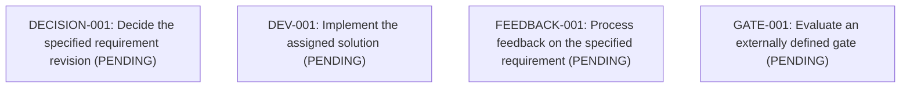

# example-feature — TASKS

YAML in tasks/ is the state source. Common columns show ownership, dependencies, timestamps and commit points; type-specific metadata is summarized in detail spec. Sample tasks prescribe no workflow or company policy.

## preview-table

<!-- tasks-preview-table:start -->
| id | type | title | state | owner | depends on | started at | completed at | head sha | detail spec |
| --- | --- | --- | --- | --- | --- | --- | --- | --- | --- |
| [DECISION-001](tasks/DECISION-001.md) | decision | Decide the specified requirement revision | PENDING | - | - | - | - | - | revision: v1 inputs: REQ-001@v1 result: {executio... |
| [DEV-001](tasks/DEV-001.md) | development | Implement the assigned solution | PENDING | - | - | - | - | - | revision: v1 inputs: REQ-001@v1, SOL-001@v1 resul... |
| [FEEDBACK-001](tasks/FEEDBACK-001.md) | feedback | Process feedback on the specified requirement | PENDING | - | - | - | - | - | revision: v1 inputs: REQ-001@v1 result: {executio... |
| [GATE-001](tasks/GATE-001.md) | gate | Evaluate an externally defined gate | PENDING | - | - | - | - | - | revision: v1 result: {execution: not_started} res... |
<!-- tasks-preview-table:end -->

## dependency-topology

<!-- tasks-dependency-topology-mermaid:start -->

<!-- tasks-dependency-topology-mermaid:end -->

## complementary

Append dated notes here (YYYY-MM-DD — note). Maintain this section and the introduction, not generated regions.
