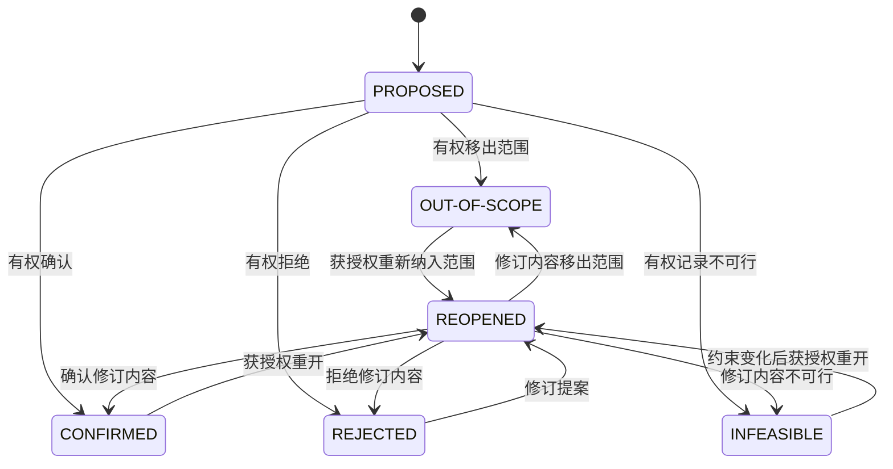

# 逐点决定、版本与重开

决定、部分接受、修订或重开 REQ/SOL 等需判定的设计点时读取。INT 的提出者与来源语义、设计点创建与关联参见 [decisions.md](decisions.md)。

## 设计点状态机

下图适用于 REQ/SOL 等需要判定的设计点。INT 在提出并留存来源时已经是 RECORDED，不等待此审批流；纠正 INT 时保留提出者和原始说明，不清空来源身份。

设计点状态不等于处理它的任务状态；任务生命周期参见 [transitions.md](transitions.md)。状态转换不要求每点一个 commit，也不固定要求由人类确认。

## 明确决定范围

确定准确的点集合、内容版本、拟作结果、实际确认者和适用委托。明确的批量决定可以指向固定点集合；含糊的“看起来不错”不能静默批准其他点或未来版本。将自然语言决定映射到实际范围，不要求用户操作内部 ID。

建议不等于有权作决定。获有效委托的 agent 可在范围内判断，不固定追加人工二次确认；能力、信心和学习偏好不能扩张权限。

只接受一个点的一部分时，单独记录被接受范围，必要时拆为稳定子点；不能把尚未解决的内容标为已确认。

## AGENTS.md 角色授权

REQ 和 SOL 可以由依据适用 AGENTS.md 中有效角色授权作业的 agent 确认为 CONFIRMED。例如，外部授权可以允许指定角色在工作简单且明确列出的条件满足时直接确认。已有有效授权时不再固定追加人工二次确认。角色身份、何为简单、适用条件、允许的理由及限制属于 agent 配置，不由本 skill 定义，也不据此默认豁免所有 agent。

每次此类确认都必须明确对象及版本、适用角色和授权、实际满足的条件以及具体确认理由。decided by 写实际确认的 agent，decided at 写决定时间，decided with 必须写非空且有实质内容的理由。在 DECISION 任务或指定持久决定记录中，用授权引用保留 AGENTS.md 的规则位置及版本，在决定评论中说明条件如何满足。仅有角色名、信心或“简单”二字不构成理由。此例外改变的是谁可以确认，不豁免理由、范围和历史记录要求。

授权缺失或条件不满足时，确认保持未决。结构校验器检查记录格式及必填理由，不判断授权是否适用或业务条件是否成立；被委托的 agent 应依据实际配置建立判定依据。

## 记录结果及依据

在 DECISION 任务或外部提供的持久决定记录中，保存对象版本、结论、权限与评论。设计点的 decided by、decided at、decided with 与该结果一致，使用实际确认者和决定时间，不使用代为抄录者。

CONFIRMED、REJECTED、OUT-OF-SCOPE、INFEASIBLE 是已决定结果；拒绝和范围外提案仍需可发现，不能删除。intent 的 RECORDED 只说明外部原话已记录，不表示加工后的方案已批准。拒绝的处理可以完成决定任务，但不会把需求变为已确认。

## 修订不改写批准历史

草稿可在委托范围内细化。修改已决定点时建立新版本或明确的持久变更记录，保留旧元数据、正文、决定和理由。重开已确认、范围外或不可行结果，取得外部策略所需权限，不必固定由人类作出。拒绝提案可修订，但不能把被拒版本伪装为已接受。

确认权限本身不授权 CONFIRMED → REOPENED。重开前还需核实有效授权覆盖重开动作，并满足其列明条件；保留先前 CONFIRMED 状态、确认者、理由和版本，在持久变更/决定记录中记录本次重开的理由及授权。否则保持 CONFIRMED，将拟议变更交由相应有权主体决定。具体重开条件由适用 AGENTS.md 或外部策略定义，本 skill 不提供自动重开豁免。

当前提案重开时，先保留旧决定，再使用 REOPENED 并同时清空当前决定字段；记录变化理由、后续决定权限和输入版本。再次确认只适用于修订内容。

检查下游方案、任务、测试、验收和 GATE 依据是否过期；没有重新作业，不能将它们记录的对象改成新版本或 SHA。DESIGN 预览设计点，STATUS 可汇总影响，不另行产生“整份文档批准”。

### 流程通知I/O

准确的确认请求或可归属决定保存后，调用方可通过[通知hook](notification-hooks.md)传递对象版本及关联。投递不改变确认状态，实际权限仍按上述规则判断。
