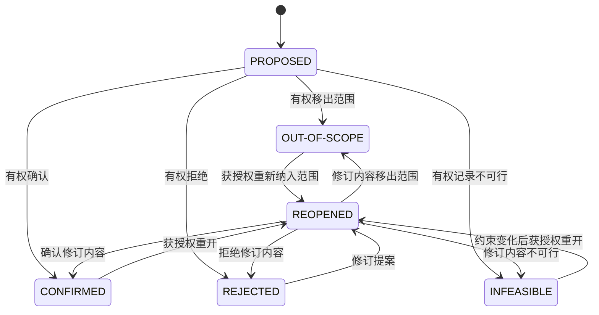

# 逐点决定、版本与重开

决定、部分接受、修订或重开 REQ/SOL 等需判定的设计点时读取。INT 的提出者与来源语义、设计点创建与关联参见 [decisions.md](decisions.md)。

## 设计点状态机

下图适用于 REQ/SOL 等需要判定的设计点。INT 在提出并留存来源时已经是 RECORDED，不等待此审批流；纠正 INT 时保留提出者和原始说明，不清空来源身份。

设计点状态不等于处理它的任务状态；任务生命周期参见 [transitions.md](transitions.md)。状态转换不要求每点一个 commit，也不固定要求由人类确认。

## 明确决定范围

确定准确的点集合、内容版本、拟作结果、实际确认者和适用委托。明确的批量决定可以指向固定点集合；含糊的“看起来不错”不能静默批准其他点或未来版本。将自然语言决定映射到实际范围，不要求用户操作内部 ID。

建议不等于有权作决定。获有效委托的 agent 可在范围内判断，不固定追加人工二次确认；能力、信心和学习偏好不能扩张权限。

只接受一个点的一部分时，单独记录被接受范围，必要时拆为稳定子点；不能把尚未解决的内容标为已确认。

## 记录结果及依据

在 DECISION 任务或外部提供的持久决定记录中，保存对象版本、结论、权限与评论。设计点的 decided by、decided at、decided with 与该结果一致，使用实际确认者和决定时间，不使用代为抄录者。

CONFIRMED、REJECTED、OUT-OF-SCOPE、INFEASIBLE 是已决定结果；拒绝和范围外提案仍需可发现，不能删除。intent 的 RECORDED 只说明外部原话已记录，不表示加工后的方案已批准。拒绝的处理可以完成决定任务，但不会把需求变为已确认。

## 修订不改写批准历史

草稿可在委托范围内细化。修改已决定点时建立新版本或明确的持久变更记录，保留旧元数据、正文、决定和理由。重开已确认、范围外或不可行结果，取得外部策略所需权限，不必固定由人类作出。拒绝提案可修订，但不能把被拒版本伪装为已接受。

当前提案重开时，先保留旧决定，再使用 REOPENED 并同时清空当前决定字段；记录变化理由、后续决定权限和输入版本。再次确认只适用于修订内容。

检查下游方案、任务、测试、验收和 GATE 依据是否过期；没有重新作业，不能将它们记录的对象改成新版本或 SHA。DESIGN 预览设计点，STATUS 可汇总影响，不另行产生“整份文档批准”。
