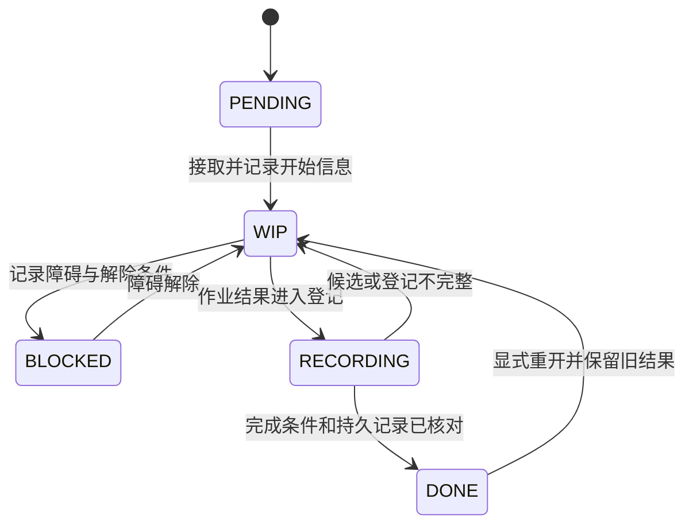

# 任务状态变更

分派、阻塞、完成或重开任务时读取。这些是共享状态含义与记录要求，调度、流转权限和持久化方式由外部提供。

## Task 状态机

这是各类任务共享的状态机，保留阻塞、退回和重开路径；不是固定的设计→开发→评审→发布流程。后面的事件表规定每次转换需要留下的记录，谁可以转换由外部权限决定。

## 就绪不是额外存储状态

PENDING 表示未接取。可用 READY/WAITING 描述直接依赖是否全部 DONE，但不把它们存为生命周期状态。BLOCKED 表示已接取任务遇到具体障碍，需要记录影响和解除条件；尚未接取且等待依赖的任务仍是 PENDING。

依赖 DONE 不保证结果成功；继续前还要检查所需结果或授权。

## 记录实际发生的事件

| 事件 | 状态记录 | 相关更新 |
| --- | --- | --- |
| 接取并开始作业 | PENDING → WIP | 记录 owner、started at、实际范围和输入/基线版本；代码工作记录对应仓库提交点。 |
| 已接取工作受阻 | WIP → BLOCKED | 记录 blocker、影响、解除条件、后续负责人和 resume action。 |
| 障碍解除 | BLOCKED → WIP | 记录解除依据；基线变化或新 attempt 应追加记录，不覆盖旧版。 |
| 作业进入结果登记 | WIP → RECORDING | 明确候选、实际结果、已执行检查和剩余问题，核对所需报告与引用。 |
| 登记完成 | RECORDING → DONE | 核对任务完成条件，记录 completed at 和持久结果，更新预览。代码产物记录 Project 限定的提交点，非代码工作不编造 commit。 |
| 候选或登记不完整 | RECORDING → WIP | 记录失败检查、缺失材料和下一步，不伪造完成记录。 |
| 显式重开已完成工作 | DONE → WIP | 记录 reopen reason 和适用授权，保留之前的完成结果/版本，清空当前 completed at 并记录新 attempt。 |

中断本身不代表 BLOCKED；保持 WIP 并留下准确的 resume action。FAILURE 与 REOPEN 是事件，不是额外生命周期状态。DONE 表示委托工作及其记录已经完成，测试完成可以失败，决定完成可以拒绝。

重开后不能把旧结果/证据当成对新候选的检查；旧报告保存在历史版本或持久任务段落中，当前结果另行标明。

## 一致性与 Feature 概况

通过外部写入接口协调详情和受影响 STATUS 概况，再用[生成器](generated-indexes.md)更新 TASKS 预览与依赖拓扑，不手动维护生成区。只读或打印表格的工具不提供跨文件原子性。遇到部分写入时报告，并按权威详情核对，不覆盖其他维护者的变更。

STATUS 只更新受影响的仓库/Feature/开发综合状态，不镜像全部任务行。任务 DONE 本身不改变 Feature 阶段，也不授权发布，应使用外部提供的 [GATE](gates.md) 策略。

设计点决定与处理该决定的任务生命周期分别表达，参见 [confirmation.md](confirmation.md)。
